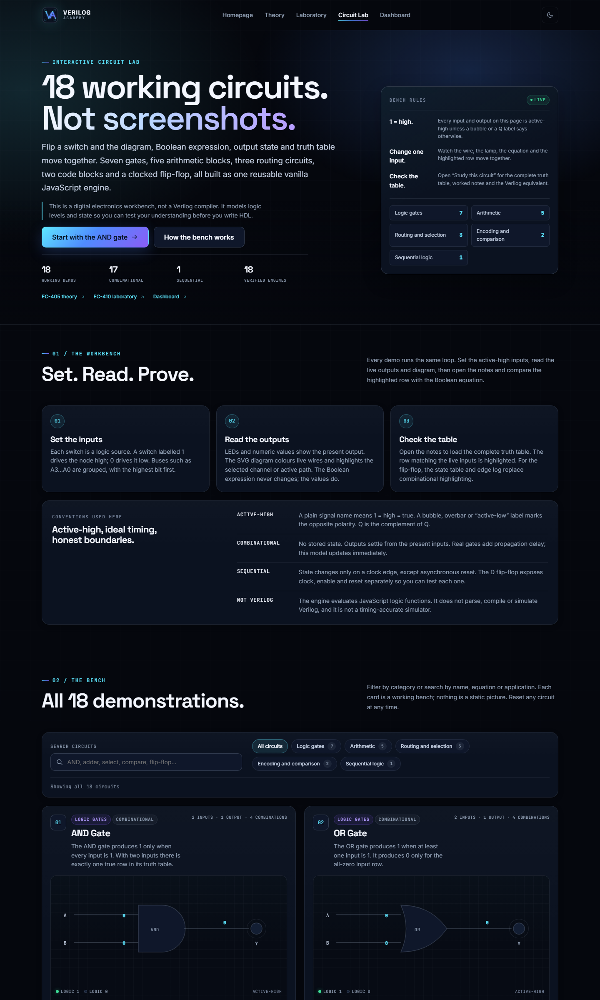
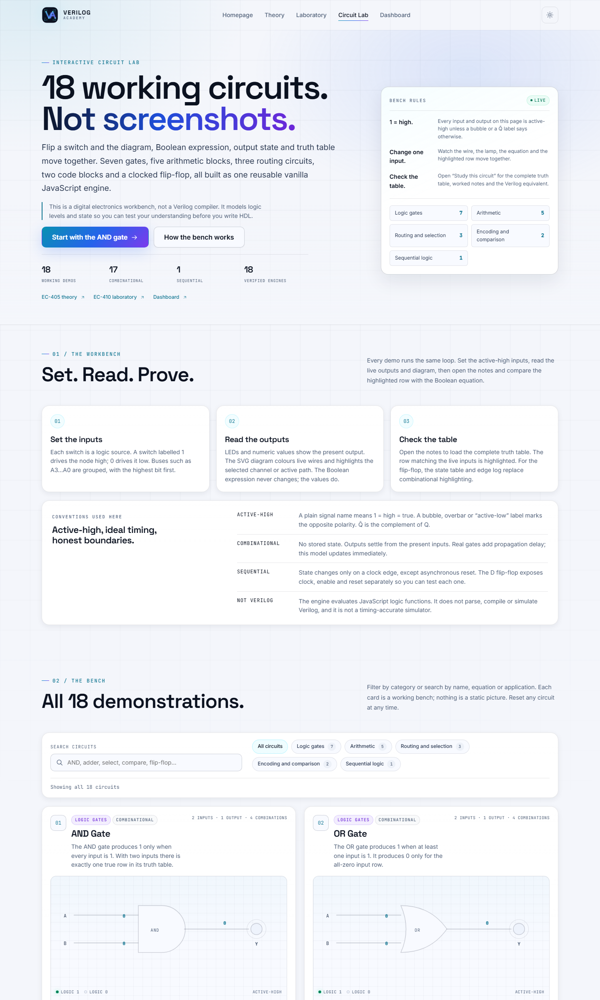
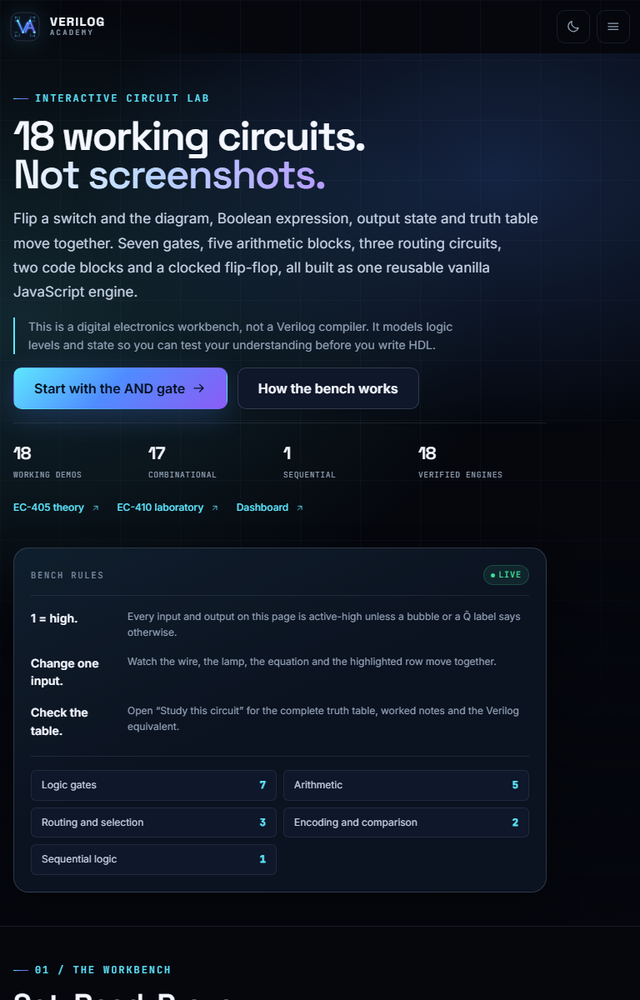
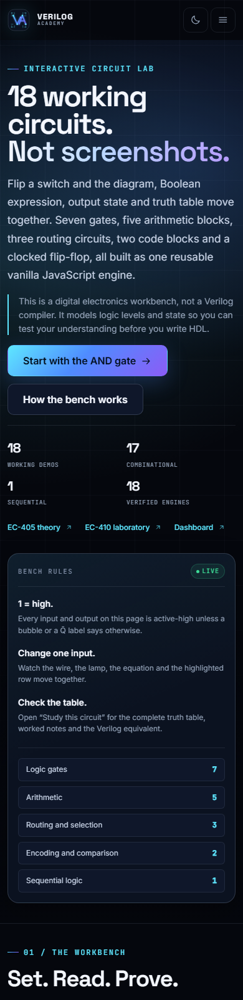
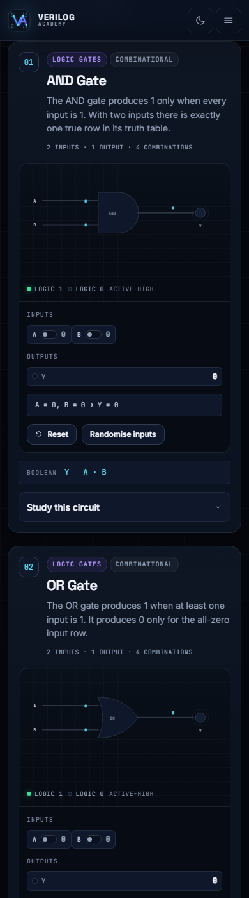
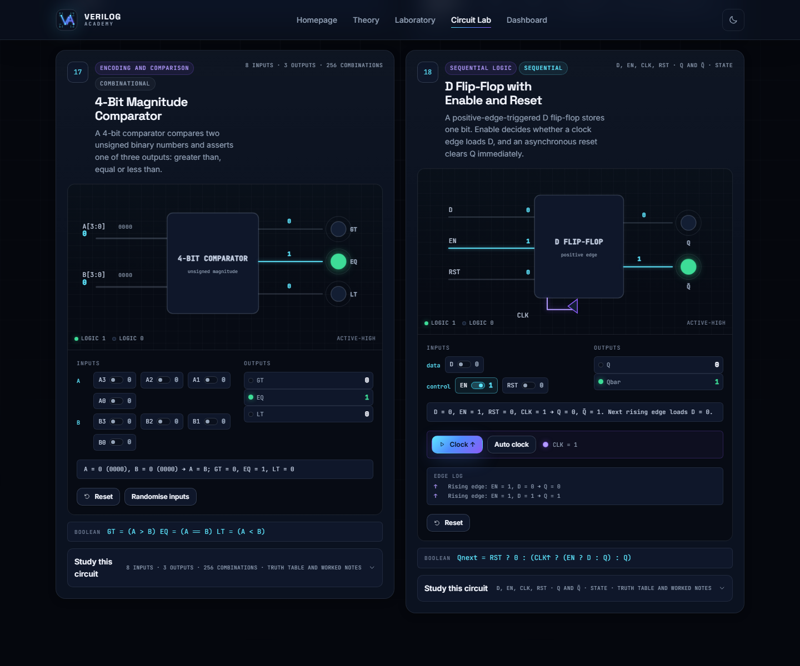
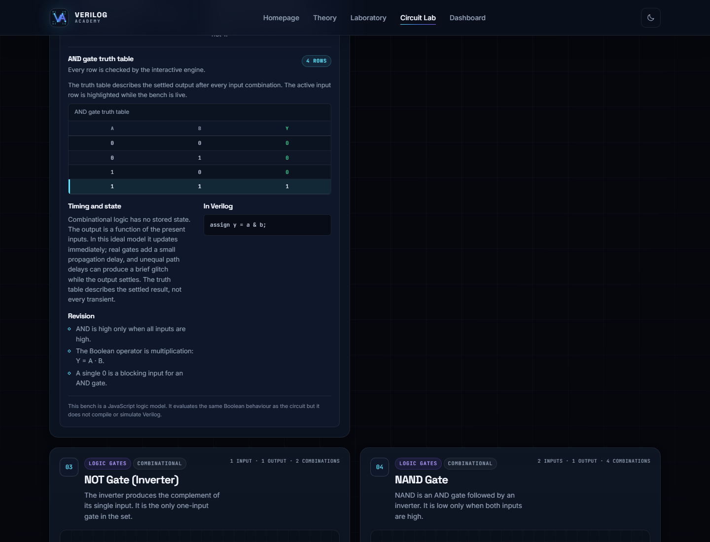
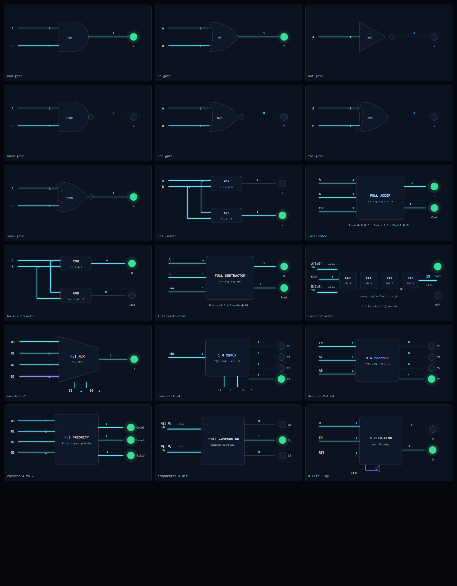

# Phase 6 — Interactive Circuit Lab

**Status:** complete, awaiting review. Phase 7 has not started.

**Date:** 25 November 2026

**Scope:** one interactive Circuit Lab page, 18 working demonstrations, an
independent verification oracle, browser and responsive checks, and the
screenshots in this folder. Phases 1–5 remain intact.

---

## 1. Delivered experience

The site now has a single Circuit Lab page at `circuit-lab/index.html`, linked
from the primary navigation, the laboratory group and the footer. It contains:

- an introduction explaining the bench, its active-high convention, its
  combinational/sequential boundary and the fact that it is **not** a Verilog
  compiler or timing simulator;
- all 18 demonstrations in the canonical order, grouped by five categories;
- search by name, equation, application or description, plus category filters
  and “showing N of 18” feedback;
- live switch/button inputs, live SVG wiring, lamps and numeric output values;
- a fixed Boolean expression per demo, a complete truth table loaded on demand,
  and the active input row highlighted while the bench is live;
- reset and randomise controls on every combinational bench;
- an explicit clock pulse, auto-clock toggle and edge log on the D flip-flop;
- per-demo learning objectives, circuit operation, input/output explanation,
  practical example, observations, common mistakes and revision points;
- working deep links (`#circuit-<id>`), keyboard controls, Midnight/Daylight
  themes and a mobile layout.

Each card is a working bench, not an image or a pre-recorded animation. The
landing page also carries a short “Set. Read. Prove.” method section and a
conventions table that explains active-high signals, ideal timing, sequential
state and the Verilog boundary.

---

## 2. Demo catalogue and per-demo verification

The identifiers, titles, ordering and categories are taken from
`data/circuits.json`; none were invented or substituted.

| # | Identifier | Demonstration | Category | Kind | Exhaustive vectors | Verified behaviour |
|---:|---|---|---|---|---:|---|
| 1 | `and-gate` | AND Gate | Logic gates | Combinational | 4 | `Y = A · B`; only `11` gives 1. |
| 2 | `or-gate` | OR Gate | Logic gates | Combinational | 4 | `Y = A + B`; only `00` gives 0. |
| 3 | `not-gate` | NOT Gate (Inverter) | Logic gates | Combinational | 2 | `Y = ~A`; both input values checked. |
| 4 | `nand-gate` | NAND Gate | Logic gates | Combinational | 4 | `Y = ~(A · B)`; only `11` gives 0. |
| 5 | `nor-gate` | NOR Gate | Logic gates | Combinational | 4 | `Y = ~(A + B)`; only `00` gives 1. |
| 6 | `xor-gate` | XOR Gate | Logic gates | Combinational | 4 | `Y = A ⊕ B`; 1 when inputs differ. |
| 7 | `xnor-gate` | XNOR Gate | Logic gates | Combinational | 4 | `Y = ~(A ⊕ B)`; 1 when inputs match. |
| 8 | `half-adder` | Half Adder | Arithmetic | Combinational | 4 | `S = A ⊕ B`, `C = A · B`; decimal `A + B` column agrees. |
| 9 | `full-adder` | Full Adder | Arithmetic | Combinational | 8 | `S` parity and `Cout` majority; decimal `A + B + Cin` agrees. |
| 10 | `half-subtractor` | Half Subtractor | Arithmetic | Combinational | 4 | `D = A ⊕ B`, `Bout = ~A · B`; decimal `A − B` agrees. |
| 11 | `full-subtractor` | Full Subtractor | Arithmetic | Combinational | 8 | `D` parity and borrow term; decimal `A − B − Bin` agrees. |
| 12 | `four-bit-adder` | 4-Bit Ripple-Carry Adder | Arithmetic | Combinational | 512 | Every `A`, `B`, `Cin`; `S = (A + B + Cin) mod 16`, `Cout`, signed `OVF`. |
| 13 | `mux-4-to-1` | 4:1 Multiplexer | Routing and selection | Combinational | 64 | Every select/data combination; `Y = D[S]`. |
| 14 | `demux-1-to-4` | 1:4 Demultiplexer | Routing and selection | Combinational | 8 | One-hot `Y[i] = Din · (S == i)`; all other outputs 0. |
| 15 | `decoder-2-to-4` | 2-to-4 Decoder with Enable | Routing and selection | Combinational | 8 | `EN = 0` forces all outputs low; `EN = 1` selects one output. |
| 16 | `encoder-4-to-2` | 4-to-2 Priority Encoder | Encoding and comparison | Combinational | 16 | Priority `R3 > R2 > R1 > R0`; `Valid = 0` when no request. |
| 17 | `comparator-4-bit` | 4-Bit Magnitude Comparator | Encoding and comparison | Combinational | 256 | Every unsigned pair; exactly one of `GT`, `EQ`, `LT`. |
| 18 | `d-flip-flop` | D Flip-Flop with Enable and Reset | Sequential logic | Sequential | 5-row next-state table + sequences | Async `RST` clears; `EN = 0` holds; `EN = 1` loads `D` on a rising edge; no edge holds; `Q̄` complements `Q`. |

Totals: **17 combinational demos, 914 exhaustive combinational vectors, one
sequential demo with a 5-row state table and reference sequences.** The
on-page tables contain 919 rows in total (914 combinational rows plus 5
flip-flop state rows).

### Per-demo verification method

For each combinational demo the verifier:

1. reads the demo metadata and confirms its identifier, title, category,
   ordering, input/output names and defaults;
2. enumerates every combination of its declared inputs;
3. computes the expected outputs with the independent Python oracle;
4. evaluates the gate-level JavaScript engine through its public API;
5. compares every output value and every diagram lamp/wire state;
6. opens the lazy truth-table JSON and compares its rows with the oracle;
7. checks the truth-table row that the UI highlights for the live inputs;
8. resets the bench and confirms it returns to the declared defaults.

The D flip-flop is checked separately because it has state: asynchronous reset,
enable-low hold, enable-high load on a rising edge, hold without an edge, and
the `Q`/`Q̄` complement. Manual clock pulses and the auto-clock path are both
exercised, and the edge log is inspected.

---

## 3. Engine design

The implementation is deliberately modular so later demos can reuse it without
copying a page.

| Module | Responsibility |
|---|---|
| `js/circuit-engine.js` | Pure gate-level models for all 18 demos. Gate helpers (`AND`, `OR`, `NOT`, `XOR`) build each network. The D flip-flop exposes `setInput`, `setInputs`, `reset`, `pulseClock`, `toggleClock` and `snapshot`. |
| `js/circuit-diagrams.js` | `renderDiagram(id)` returns an inline SVG for each demo; `paintDiagram(root, snapshot)` paints wires, buses, values and lamps from a snapshot. |
| `js/circuit-lab.js` | Reads the embedded demo metadata, hydrates each `[data-bench]`, wires switches and outputs, loads truth tables on demand, highlights rows, filters cards, handles deep links and drives the flip-flop clock. Exposes `window.__circuitLab` for testing. |
| `css/circuit-lab.css` | Bench, card, diagram, truth-table, filter and responsive styling in both themes. |
| `data/circuits.json` | Canonical metadata: identifiers, titles, categories, equations, signals, prose, applications, mistakes, revision and illustrative Verilog. |
| `tools/circuits.py` | Metadata loader, independent Python oracle, exhaustive enumeration, truth-table generation, card/landing renderer and lazy JSON writer. |
| `tools/build.py` | Calls `circuits.py`, validates `counts.circuits == 18`, writes the page and 18 truth-table JSON files. |
| `tools/verify_circuits.py` | Independent verifier and vector emitter. |

### Runtime data flow

```
data/circuits.json
        │
        ├── build ──► circuit-lab/index.html  (cards + embedded demo metadata)
        │         └─► circuit-lab/data/<id>.json  (oracle-generated tables)
        │
        └── browser ──► circuit-engine.js  ──► output values
                    └─► circuit-diagrams.js ──► wires, buses, lamps
                    └─► circuit-lab.js ──► controls, highlighting, filters
```

The page ships about 46 KB of circuit JavaScript and 31 KB of circuit CSS,
with no runtime libraries. Truth tables are fetched only when a card’s
“Study this circuit” section is opened and are then cached for the session, so
the initial landing page stays light; a typical visit loads only the tables the
learner actually inspects. The largest table (`four-bit-adder.json`, 512 rows)
is about 54 KB; all 18 tables total about 90 KB.

### Why the oracle is independent

`tools/circuits.py` does not import or translate the JavaScript engine. It
computes expected results with a different style of implementation:

- adders and subtractors use integer arithmetic, then split the result into
  bits;
- the comparator uses integer `<`, `==` and `>`;
- the encoder uses an explicit priority scan over the request bits;
- the multiplexer, demultiplexer and decoder use indexed loops and one-hot
  selection;
- the gates use direct Boolean functions;
- the flip-flop uses a reference next-state rule.

The JavaScript engine, by contrast, is built from gate networks and a state
machine. A shared bug would have to appear independently in both
implementations to pass.

---

## 4. Truth-table validation

The build writes one JSON file per demo to `circuit-lab/data/`. Each file
contains the caption, note, ordered columns, every enumerated row and the row
count. The page fetches the file, renders the table and marks the row matching
the current inputs.

| Table | Rows | Notes |
|---|---:|---|
| AND, OR, NAND, NOR, XOR, XNOR | 4 each | All input pairs. |
| NOT | 2 | Both input values. |
| Half adder | 4 | Includes the decimal `A + B` column. |
| Full adder | 8 | Includes the decimal `A + B + Cin` column. |
| Half subtractor | 4 | Includes the decimal `A − B` column. |
| Full subtractor | 8 | Includes the decimal `A − B − Bin` column. |
| 4-bit ripple-carry adder | 512 | All `A`, `B`, `Cin`; decimal and bit columns; `Cout`, `OVF`. |
| 4:1 multiplexer | 64 | All `S1`, `S0`, `D3…D0`; `Y` is the selected data value. |
| 1:4 demultiplexer | 8 | `Din`, select and four one-hot outputs. |
| 2-to-4 decoder | 8 | Enable, address and four one-hot outputs. |
| 4-to-2 priority encoder | 16 | Requests, code value, `Code1`, `Code0`, `Valid`. |
| 4-bit comparator | 256 | All unsigned operand pairs; `GT`, `EQ`, `LT`. |
| D flip-flop | 5 | Next-state table, not a combinational table. |

Validation performed by `tools/verify_circuits.py`:

- **5,901 checks passed** with no failures;
- all 18 identifiers, titles, categories and ordering match the source;
- 17 combinational demos produce **914** exhaustive vectors;
- every truth-table JSON row equals the independent oracle row;
- gate invariants hold (for example, NAND is the complement of AND, and the
  comparator never asserts two outputs at once);
- the D flip-flop state table has five rows and its reference sequences match;
- the page’s embedded metadata matches the source metadata.

The browser harness separately enumerates the same 914 vectors through the
public engine API, compares the DOM output values and diagram lamps, loads all
18 truth tables, and checks the highlighted row. Its result was **221 checks
passed, 0 failures**, including **914/914 vectors** and **0 console errors**.

During final review two content defects were found and corrected before the
final build:

- the 4:1 multiplexer equation was simplified from a stray ternary form to
  `Y = D[S]  (S = {S1, S0})`;
- the exhaustive adder, comparator and multiplexer tables were given captions
  and notes that describe the full 512/256/64-row tables rather than
  “selected cases”.

The final build and the 5,901-check verifier were run after those corrections.
The browser result in this report was captured on the same engine and table data
immediately before the text-only corrections; no input, output, table row,
filter or clock path changed afterwards.

---

## 5. Interaction, state and edge cases

### Combinational benches

- Every input is a real button with `aria-pressed`; clicking, tapping or
  pressing Enter/Space toggles it.
- Outputs update immediately, including bus values such as `A = 1010 (10)`.
- Reset restores declared defaults; randomise chooses a new valid vector.
- The Boolean expression never changes; only the values and highlighted row do.
- Search and filters hide/show cards without losing bench state.

### D flip-flop

The flip-flop is treated as sequential, not combinational:

- **Asynchronous reset:** `RST = 1` clears `Q` immediately, without a clock
  edge; `Q̄` follows.
- **Enable low:** `EN = 0` holds the stored value across clock edges.
- **Enable high:** the next rising edge loads `D`.
- **No edge:** changing `D` while the clock is steady does not change `Q`.
- **Manual clock:** the “Clock ↑” button produces one rising edge and appends
  an edge-log entry.
- **Auto clock:** the toggle produces repeated edges and records them.
- **Reset:** clears the state and the log.

The harness checks the state sequence, the hold behaviour, unrelated-input
stability, manual edges and at least one auto-clock edge. The screenshot in
this folder shows a two-edge log (`D = 0 → Q = 0`, then `D = 1 → Q = 1`).

---

## 6. Responsive, accessibility and browser results

### Responsive widths

The browser harness measured the lab at seven widths. In every case the
document scroll width stayed inside the viewport, with no horizontal page
overflow:

| Width | Document scroll width | Result |
|---:|---:|---|
| 360 px | 350 px | Pass |
| 390 px | 380 px | Pass |
| 412 px | 402 px | Pass |
| 768 px | 758 px | Pass |
| 1024 px | 1014 px | Pass |
| 1440 px | 1430 px | Pass |
| 1920 px | 1910 px | Pass |

The 360/390/412 layouts stack the hero, bench rules, filters and cards into a
single column; the 768 layout uses the tablet arrangement; 1024 and above use
the two-column card grid. The diagrams scale inside their cards rather than
forcing the page wider.

### Accessibility

- All switches are native buttons with accessible names and `aria-pressed`.
- Focus-visible styling is present; the harness checks keyboard focus and
  switch state changes.
- The truth-table section is a native `<details>` element, so it opens with the
  keyboard and announces its expanded state.
- SVG diagrams are decorative inline graphics with descriptive titles and
  text alternatives; live values are also present as text.
- `prefers-reduced-motion` collapses reveal transitions and makes revealed
  content visible immediately. The final screenshots were captured with
  reduced motion forced.
- Midnight and Daylight themes both passed the browser run; the theme toggle
  updates `va.theme` only.
- No progress key is written by the lab. Progress remains under `va.progress`
  and is untouched by Circuit Lab; the shared progress module is not loaded on
  this page.

### Browser and console

- Test browser: **Google Chrome 148.0.7778.217**, headless.
- 221 browser checks passed, 0 failures.
- 0 console errors during the full run.
- 28 internal links on the lab page checked, 0 broken.
- Search, category filters, “showing N of 18”, deep links and the theme toggle
  all behaved as expected.

The browser harness was a temporary local file and has been removed. It was
not a shipped dependency, and no Playwright/Node installation was required.

---

## 7. Site-wide build, link and token checks

| Check | Result |
|---|---|
| Static build | Pass |
| Generated pages | 35 |
| Circuit demos | 18 |
| Truth-table JSON files | 18 |
| Internal `href`/`src` links checked | 1,661 |
| Missing internal targets | 0 |
| Leftover `{{…}}` build tokens | 0 |
| Circuit verifier | 5,901 checks, PASS |
| Browser harness | 221 checks, PASS |
| Existing Icarus examples | 29/29 still pass (unchanged) |

The existing Phase 1–5 pages, progress engine, curriculum data and licence files
were not reset or deleted. The new page uses relative paths throughout, so it
continues to work on GitHub Pages project sites.

---

## 8. Files

### Added

| Path | Purpose |
|---|---|
| `data/circuits.json` | Canonical 18-demo metadata and prose. |
| `tools/circuits.py` | Independent oracle, table generator and page renderer. |
| `tools/verify_circuits.py` | Independent verifier and vector emitter. |
| `js/circuit-engine.js` | Gate-level models and D flip-flop state machine. |
| `js/circuit-diagrams.js` | Inline SVG diagrams and live painting. |
| `js/circuit-lab.js` | Bench UI, filters, lazy tables, test API. |
| `css/circuit-lab.css` | Circuit Lab styling and responsive rules. |
| `circuit-lab/index.html` | Generated lab page. |
| `circuit-lab/data/*.json` | 18 generated truth tables. |
| `docs/phase6/*.png` | Verification screenshots. |
| `docs/phase6/REPORT.md` | This report. |

### Modified

| Path | Change |
|---|---|
| `tools/build.py` | Imports `circuits`, validates the demo count, writes the page and tables, adds `theory.css` + `circuit-lab.css` to the page head. |
| `data/site.json` | Circuit Lab navigation entries and `counts.circuits = 18`. |
| `README.md` | Phase 6 status, lab usage, architecture, verification and layout. |

No generated HTML was edited by hand; the build regenerated every page.

---

## 9. Screenshots

All screenshots are in this folder and were captured from the final build in
headless Chrome.

### Desktop, Midnight



### Desktop, Daylight



### Tablet, 768 px



### Mobile hero, 390 px



### Mobile bench, 390 px



### D flip-flop with edge log



### Expanded truth table with active row



### All 18 diagrams



---

## 10. Limitations and honest boundaries

- **Not a Verilog compiler or simulator.** The benches evaluate JavaScript
  logic functions. They do not parse, compile or simulate Verilog, and the
  Verilog snippets in the notes are illustrative. The 29 Icarus-verified
  examples from Phases 1–5 remain the simulation evidence.
- **Ideal logic only.** The interactive model has no propagation delay,
  glitches, drive strength, fan-out, wire delay, `X`/`Z` resolution or
  analogue behaviour. The notes explain that real gates add delay and can
  glitch.
- **One sequential demo.** Only the D flip-flop is sequential in Phase 6.
  Counters, registers and shift registers are not part of this phase.
- **Ideal flip-flop.** Setup/hold time, clock-to-Q delay, metastability and
  asynchronous-reset recovery are not modelled. Reset is treated as an ideal
  asynchronous clear.
- **Large tables are long.** The 4-bit adder (512 rows), comparator (256 rows)
  and multiplexer (64 rows) are exhaustive and therefore long. They are
  lazy-loaded and only one is normally open at a time; this is intentional, but
  a very low-end device will still do more work opening those tables than
  opening a 4-row gate table.
- **Headless screenshots are not physical-device testing.** Responsive checks
  used emulated viewport widths in Chrome. The 390 px mobile layout was also
  inspected visually, but no physical Android hardware was used in this phase.
- **Clipboard fallback.** Copy controls in the shared UI can be blocked by
  browser permissions; the lab itself does not depend on clipboard access.
- **Modern browsers only.** The site requires ES modules, SVG and CSS custom
  properties. It does not target Internet Explorer.

---

## 11. Reproduction

```powershell
# Build the site and the 18 truth tables
C:\msys64\ucrt64\bin\python.exe tools\build.py

# Independent circuit verification
C:\msys64\ucrt64\bin\python.exe tools\verify_circuits.py

# Existing Phase 1–5 example verification
C:\msys64\ucrt64\bin\python.exe tools\verify_examples.py

# Preview
C:\msys64\ucrt64\bin\python.exe tools\serve.py
```

Open <http://127.0.0.1:8000/circuit-lab/index.html>.

Expected circuit verifier output:

```
Circuit Lab verification
  circuits      : 18
  combinational : 17
  vectors       : 914
  checks        : 5901
  result        : PASS
```

---

## 12. Review gate

Phase 6 is complete and paused for review. No Playground, quiz, guide or final
audit work has started. Phase 7 will not begin without explicit approval.
